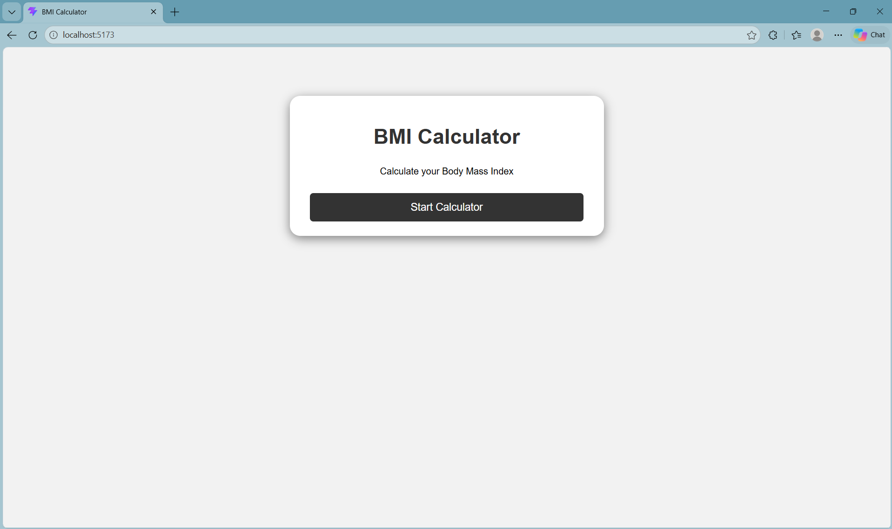
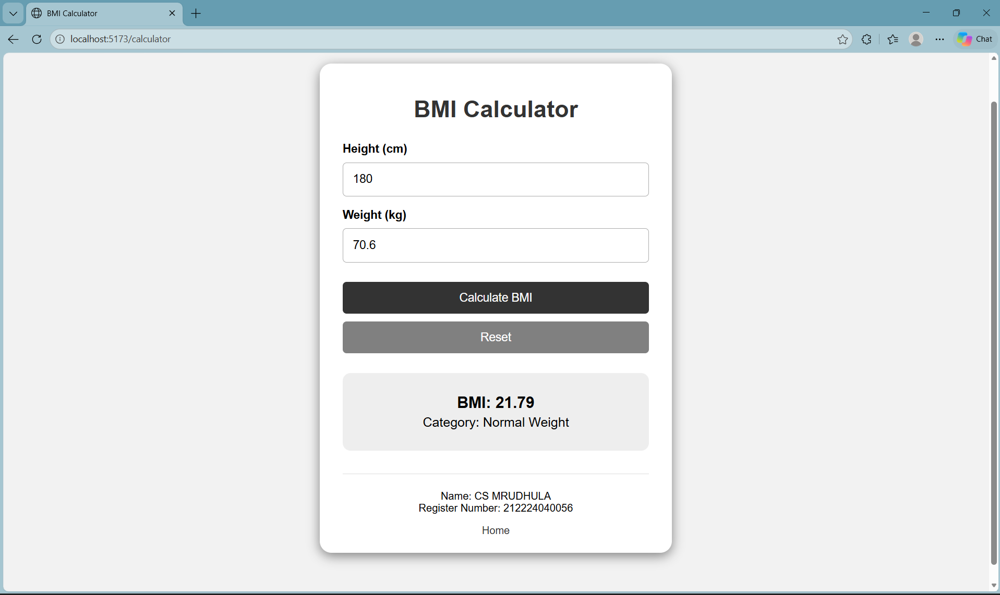

# Ex06 BMI Calculator

## Date: 

## AIM
To create a BMI calculator using React Router 

## ALGORITHM
### STEP 1 State Initialization
Manage the current page (Home or Calculator) using React Router.

### STEP 2 User Input
Accept weight and height inputs from the user.

### STEP 3 BMI Calculation
Calculate the BMI based on user input.

### STEP 4 Categorization
Classify the BMI result into categories (Underweight, Normal weight, Overweight, Obesity).

### STEP 5 Navigation
Navigate between pages using React Router.

## PROGRAM

### index.html
```

<!DOCTYPE html>
<html lang="en">
<head>
    <meta charset="UTF-8">
    <meta name="viewport" content="width=device-width, initial-scale=1.0">
    <title>BMI Calculator</title>
</head>
<body>
    <div id="root"></div>
    <script type="module" src="/src/main.jsx"></script>
</body>
</html>

```

### main.jsx
```

import React from 'react';
import ReactDOM from 'react-dom/client';
import { BrowserRouter } from 'react-router-dom';
import App from './App';
import './App.css';

ReactDOM.createRoot(document.getElementById('root')).render(
    <BrowserRouter>
        <App />
    </BrowserRouter>
);

```

### App.jsx

```

import React, { useState } from 'react';
import { Routes, Route, Link } from 'react-router-dom';

function Home() {
    return (
        <div className="container">
            <h1>BMI Calculator</h1>
            <p>Calculate your Body Mass Index</p>
            <Link to="/calculator">
                <button>Start Calculator</button>
            </Link>
        </div>
    );
}

function Calculator() {
    const [height, setHeight] = useState('');
    const [weight, setWeight] = useState('');
    const [bmi, setBmi] = useState(null);
    const [category, setCategory] = useState('');

    const calculateBMI = () => {
        if (height <= 0 || weight <= 0 || !height || !weight) {
            alert("Please enter valid height and weight");
            return;
        }

        const h = height / 100;
        const result = weight / (h * h);

        setBmi(result.toFixed(2));

        if (result < 18.5) {
            setCategory("Underweight");
        } else if (result < 25) {
            setCategory("Normal Weight");
        } else if (result < 30) {
            setCategory("Overweight");
        } else {
            setCategory("Obesity");
        }
    };

    const reset = () => {
        setHeight('');
        setWeight('');
        setBmi(null);
        setCategory('');
    };

    return (
        <div className="container">
            <h1>BMI Calculator</h1>

            <label>Height (cm)</label>
            <input
                type="number"
                value={height}
                onChange={(e) => setHeight(e.target.value)}
                placeholder="Enter height"
            />

            <label>Weight (kg)</label>
            <input
                type="number"
                value={weight}
                onChange={(e) => setWeight(e.target.value)}
                placeholder="Enter weight"
            />

            <button onClick={calculateBMI}>Calculate BMI</button>

            <button className="reset" onClick={reset}>Reset</button>

            {bmi !== null && (
                <div className="result">
                    <h2>BMI: {bmi}</h2>
                    <p>Category: {category}</p>
                </div>
            )}

            <hr />

            <p className="footer">
                Name: CS MRUDHULA <br/>
                Register Number: 212224040056 <br/>
            </p>

            <Link to="/">Home</Link>
        </div>
    );
}

function App() {
    return (
        <Routes>
            <Route path="/" element={<Home />} />
            <Route path="/calculator" element={<Calculator />} />
        </Routes>
    );
}

export default App;

```

### App.css

```

* {
    box-sizing: border-box;
}

body {
    margin: 0;
    font-family: Arial, sans-serif;
    background-color: #f2f2f2;
}

.container {
    width: 540px;
    margin: 85px auto;
    padding: 25px 35px;
    background-color: white;
    border-radius: 18px;
    box-shadow: 0 5px 18px gray;
    text-align: center;
}

h1 {
    font-size: 36px;
    color: #333;
    margin-bottom: 30px;
}

label {
    display: block;
    text-align: left;
    font-size: 18px;
    font-weight: bold;
    margin-bottom: 10px;
}

input {
    width: 100%;
    padding: 15px;
    margin-bottom: 18px;
    border: 1px solid #aaa;
    border-radius: 6px;
    font-size: 18px;
}

button {
    width: 100%;
    padding: 14px;
    margin-top: 12px;
    background-color: #333;
    color: white;
    border: none;
    border-radius: 6px;
    font-size: 18px;
    cursor: pointer;
}

button:hover {
    background-color: #555;
}

.reset {
    background-color: gray;
}

.result {
    background-color: #eee;
    padding: 12px;
    margin-top: 30px;
    border-radius: 12px;
}

.result h2 {
    margin-bottom: 5px;
}

.result p {
    font-size: 20px;
    margin-top: 5px;
}

hr {
    margin-top: 35px;
    border: 0;
    border-top: 1px solid #ddd;
}

.footer {
    font-size: 16px;
    margin-top: 25px;
}

a {
    color: #333;
    text-decoration: none;
}


```


## OUTPUT







## RESULT
The program for creating BMI Calculator using React Router is executed successfully.